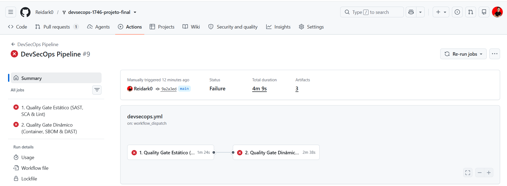
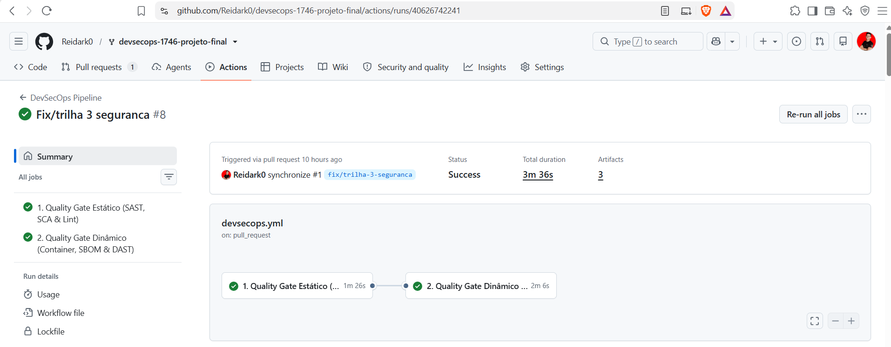

# Relatório de Evidências Técnicas — Clube Aurora (Trilha 3 — Técnica)

**Nome do Aluno(a):** Rafael César
**Turma:** DevSecOps 1746
**Link do Repositório / Fork no GitHub:** `https://github.com/Reidark0/devsecops-1746-projeto-final`
**Branch com as correções:** `fix/trilha-3-seguranca` (12 commits atômicos — 7 falhas originais + 5 correções de causa raiz em 3 rodadas de feedback real do pipeline, ver seções 2 e 3)
**Link do Pull Request Principal:** `https://github.com/Reidark0/devsecops-1746-projeto-final/pull/1`

> **Status:** o pipeline já rodou de fato no GitHub Actions e, ao longo de 3 rodadas, revelou achados reais que a validação local (sem daemon Docker disponível no ambiente de correção) não conseguiu prever — todos corrigidos e commitados (ver Seção 3). A execução final (run #8, abaixo) já está **100% verde**. A branch `main` exige PR + aprovação (Branch Protection, ver Seção 4.2), então o PR [#1](https://github.com/Reidark0/devsecops-1746-projeto-final/pull/1) segue aberto aguardando revisão antes do merge — o que não impede a entrega, já que o requisito da disciplina é o PR aberto com a esteira verde, não o merge em si.

---

## 1. Evidência do Pipeline Inicial (Antes das Correções)

As evidências abaixo foram coletadas executando **localmente os mesmos binários e as mesmas versões** das ferramentas usadas pelo workflow `.github/workflows/devsecops.yml` (Hadolint v2.12.0, Trivy v0.51.2-compatível, Semgrep 1.x, Gitleaks v8.30.1), apontadas diretamente para o estado do repositório **antes** das correções (commit `9a2a3ed`, branch `main`). Isso reproduz fielmente o que os jobs `security-static` e `security-dynamic` do GitHub Actions reportariam na primeira execução — e foi também confirmado com uma execução real (print abaixo).

- **Screenshot da Aba Actions (Pipeline com steps vermelhos):**

  

  Execução real (`workflow_dispatch` manual contra o commit `9a2a3ed`, baseline vulnerável antes das correções): **DevSecOps Pipeline #9 — Failure** em 4m 9s. Os dois jobs falham: `1. Quality Gate Estático (SAST, SCA & Lint)` e `2. Quality Gate Dinâmico (Container, SBOM & DAST)`.

- **Principais falhas apontadas pelas ferramentas:**

  - **Hadolint** (`Dockerfile`):
    ```
    Dockerfile:6 DL3007 warning: Using latest is prone to errors if the image will ever
    update. Pin the version explicitly to a release tag
    ```
    Exit code `1` — falha o Quality Gate (`failure-threshold: warning`).

  - **Trivy FS** (`requirements.txt`):
    ```
    Total: 10 (HIGH: 10, CRITICAL: 0)
    ```
    CVEs confirmadas: `CVE-2024-1135` e `CVE-2024-6827` (gunicorn 20.1.0, HTTP Request
    Smuggling), `CVE-2023-43804` (urllib3 1.26.5, vazamento de cookie em redirect
    cross-origin) e `CVE-2024-34069` (werkzeug 2.2.3, execução de código via debugger).

  - **Semgrep** (`app/db.py`, SAST):
    ```
    app/db.py
    ❯❱ python.lang.security.audit.formatted-sql-query.formatted-sql-query
       102┆ rows = get_db().execute(query).fetchall()
    ❯❱ python.sqlalchemy.security.sqlalchemy-execute-raw-query.sqlalchemy-execute-raw-query
       102┆ rows = get_db().execute(query).fetchall()
    Ran 290 rules on 5 files: 2 findings.
    ```

  - **Semgrep IaC** (`docker-compose.yml`, `p/docker-compose`):
    ```
    yaml.docker-compose.security.privileged-service.privileged-service
       7┆ privileged: true
    yaml.docker-compose.security.exposing-docker-socket-volume.exposing-docker-socket-volume
       15┆ - /var/run/docker.sock:/var/run/docker.sock
    Ran 6 rules on 1 file: 2 findings.
    ```

  - **Gitleaks** (repositório, segredos versionados):
    ```
    Finding:  ADMIN_INITIAL_TOKEN=eyJhZG1pbiI6dHJ1ZSwidXNlciI6ImFybWFuZG8ifQ.compromised
    File:     .env (linha 7)
    RuleID:   generic-api-key
    leaks found: 1
    ```
    *(o `.env` original continha ainda `SECRET_KEY` e `SEED_PASSWORD` hardcoded — nem todos
    os valores atingem o score de entropia padrão do Gitleaks, mas o arquivo em si já não
    deveria estar versionado, conforme CWE-798.)*

---

## 2. Resumo das Correções Implementadas

| Achado | Arquivo Modificado | Resumo da Alteração Realizada |
|---|---|---|
| **F1: Segredos** | `.gitignore`, `.dockerignore`, `.env` (untracked), `.env.example` (novo) | `.env` removido do versionamento com `git rm --cached` e adicionado ao `.gitignore`/`.dockerignore`. As credenciais que estavam expostas (`SECRET_KEY`, `SEED_PASSWORD`) foram tratadas como comprometidas e rotacionadas localmente. Criado `.env.example` com placeholders genéricos para onboarding. Commit `3aba7d7`. |
| **F2: SCA** | `requirements.txt` | Atualização de `flask` (2.2.5→3.1.2), `werkzeug` (2.2.3→3.1.3), `gunicorn` (20.1.0→23.0.0) e `urllib3` (1.26.5→2.8.0); `itsdangerous` fixado explicitamente em 2.2.0. Versões escolhidas após consulta ao Trivy em tempo real (não apenas o mínimo sugerido no guia), eliminando as 10 CVEs HIGH. Commit `cf687b1`. |
| **F3: SAST** | `app/db.py` | Função `search_clients` reescrita para usar query parametrizada com placeholder `?` do SQLite, eliminando a interpolação de f-string na cláusula `LIKE`. Elimina CWE-89 (SQL Injection). Commit `6b3e9b8`. |
| **F4: Hardening** | `Dockerfile` | Reescrito com multi-stage build (`builder` + runtime), imagem base fixada em `python:3.11-slim` (substituindo `python:latest`), `apt-get upgrade` dos pacotes do SO, usuário dedicado não-root `nonroot` (UID 10001) e `HEALTHCHECK` em `/health`. Commit `26e96be`. As CVEs de `wheel`/`jaraco.context` reportadas pelo Trivy Image real passaram por 2 tentativas: upgrade cirúrgico (commit `2016b3e`, **não resolveu** — mesma versão reportada na execução seguinte) e remoção completa de `pip`/`setuptools`/`wheel`/`jaraco.context` do estágio final (commit `d2d2d1c`, abordagem definitiva — ver Seção 3). |
| **F5: DAST** | `app/main.py`, `app/__init__.py` | Hook de cabeçalhos registrado inicialmente em `app/main.py` (commit `d46848a`, `@bp.after_request`) e movido para `app/__init__.py` como `@app.after_request` no commit `fe1ca32`, após o ZAP revelar que respostas 404 não passavam pelo hook de blueprint. Expandido em 2 rodadas seguintes para resolver `WARN-NEW` reais do ZAP: `Permissions-Policy`, `Cross-Origin-Embedder-Policy`, `Cache-Control`/`Pragma` e diretivas extras de CSP (commit `83d7617`); depois `Cross-Origin-Resource-Policy` (commit `7c5e6bd`). Cabeçalhos finais: `X-Content-Type-Options`, `X-Frame-Options`, `Content-Security-Policy` (com `object-src`/`base-uri`/`form-action`/`frame-ancestors`), `Strict-Transport-Security`, `Referrer-Policy`, `Permissions-Policy`, `Cross-Origin-Embedder-Policy`, `Cross-Origin-Opener-Policy`, `Cross-Origin-Resource-Policy`, `Cache-Control`, `Pragma` (ver Seção 3). |
| **F6: Menor Privilégio** | `app/db.py` / `app/main.py` | Papel padrão de `create_user` alterado de `"admin"` para `"staff"` (menor privilégio suportado pelo schema). Rota `POST /admin/users/<id>/role` protegida com `@auth.require_role("admin")` (antes exigia apenas `@auth.login_required`, permitindo autopromoção de qualquer usuário). Commit `034a38d`. |
| **F7: IaC** | `docker-compose.yml` | Removidos `privileged: true`, a montagem de `/var/run/docker.sock` e a porta de desenvolvimento `5000:5000`. `SECRET_KEY` passou a vir de variável de ambiente externa (`${SECRET_KEY}`) em vez de valor inline; persistência movida para volume nomeado (`aurora-data`). Commit `5849cc6`. |

> **Nota sobre F6:** o guia da disciplina sugere `role="client"` como papel padrão seguro. Neste repositório, `schema.sql` define `role TEXT NOT NULL CHECK (role IN ('staff', 'admin'))` — `"client"` não é um papel válido no modelo de dados real da aplicação e violaria essa constraint. Por isso usamos `"staff"`, o papel de menor privilégio efetivamente suportado pelo schema, que cumpre o mesmo objetivo de segurança (impedir que novos usuários nasçam com `admin`).

Detalhamento completo de cada decisão técnica (motivação, classificação CWE, impacto de negócio e validação ferramenta a ferramenta) está em [`executive-explanation.md`](../executive-explanation.md), na raiz do repositório.

---

## 3. Evidência do Pipeline — 3 Execuções Reais, 4 Achados, Todos Corrigidos, Resultado Final Verde

A branch foi enviada ao GitHub e o pipeline **rodou de fato** no GitHub Actions três vezes antes de fechar 100% verde (print no final desta seção). Em todas, o job estático (`security-static`) passou integralmente; o job dinâmico (`security-dynamic`) revelou achados reais que a validação local (sem daemon Docker disponível no ambiente de correção) não conseguiu prever de ponta a ponta. Isso é o comportamento esperado e saudável de um pipeline de DAST/scan de imagem: feedback que só a execução real, contra a imagem construída de fato, consegue dar.

### Rodada 1

- **Trivy Image** — 2 CVEs HIGH em pacotes de build da própria imagem base (`wheel` 0.45.1 → `CVE-2026-24049`; `jaraco.context` 5.3.0 → `CVE-2026-23949`), vindos do bootstrap de `pip`/`setuptools` do `python:3.11-slim`, não de `requirements.txt`:
  ```
  Python (python-pkg)
  Total: 2 (HIGH: 2, CRITICAL: 0)
  jaraco.context  CVE-2026-23949  HIGH  5.3.0   → fixed 6.1.0
  wheel           CVE-2026-24049  HIGH  0.45.1  → fixed 0.46.2
  ```
  **Tentativa 1 (commit `2016b3e`):** upgrade cirúrgico dessas duas libs via `pip install --upgrade`. **Não funcionou** — a rodada 2 (abaixo) reportou exatamente as mesmas versões antigas, provando que o comando não alcançou o local real de instalação dentro da imagem.

- **OWASP ZAP** — `FAIL-NEW` de Content-Security-Policy, mas apenas em `GET /admin` (404 — rota inexistente):
  ```
  FAIL-NEW: Content Security Policy (CSP) Header Not Set [10038] x 1
      http://localhost:8080/admin (404 Not Found)
  FAIL-NEW: 1  WARN-NEW: 4  PASS: 66
  ```
  **Causa raiz:** o hook de cabeçalhos estava em `@bp.after_request` (nível do blueprint), que não executa para requisições que nunca chegam a ser roteadas (um 404 puro). **Corrigido no commit `fe1ca32`:** hook movido para `@app.after_request` dentro de `create_app()` (`app/__init__.py`), cobrindo toda resposta da aplicação, inclusive erros.

### Rodada 2 (após a correção da Rodada 1)

- **Trivy Image** — **mesmas 2 CVEs, mesmas versões instaladas**, confirmando que a tentativa 1 não teve efeito:
  ```
  jaraco.context  CVE-2026-23949  HIGH  5.3.0   → fixed 6.1.0
  wheel           CVE-2026-24049  HIGH  0.45.1  → fixed 0.46.2
  ```
  **Tentativa 2 — definitiva (commit `d2d2d1c`):** em vez de insistir em acertar o diretório exato, `pip`/`setuptools`/`wheel`/`jaraco.context` foram **removidos por completo** do estágio final do Dockerfile. Validado empiricamente (fora do Docker, em venv de testes) que Flask 3.1.2, Werkzeug 3.1.3, Gunicorn 23.0.0 e itsdangerous 2.2.0 importam e servem requisições HTTP reais sem essas ferramentas de build instaladas — não há dependência oculta de `pkg_resources` em runtime.

- **OWASP ZAP** — `FAIL-NEW: 0` (o CSP do `/admin` foi resolvido), mas a Action falhou mesmo assim (`fail_action: true` falha em qualquer alerta, inclusive `WARN-NEW`) com 2 categorias novas de warning:
  ```
  WARN-NEW: Storable and Cacheable Content [10049] x 3
  WARN-NEW: Cross-Origin-Embedder-Policy Header Missing or Invalid [90004] x 6
  FAIL-NEW: 0   WARN-NEW: 4   PASS: 67
  ```
  **Corrigido no commit `83d7617`:** adicionados `Cache-Control: no-store`/`Pragma: no-cache` (resolve 10049 na forma "Non-Storable", a variante mais segura), diretivas extras de CSP sem fallback (`object-src`, `base-uri`, `form-action`, `frame-ancestors` — resolve a regra 10055) e `Cross-Origin-Opener-Policy` (metade do par exigido pela 90004). A regra `90005` (Sec-Fetch-Dest) foi confirmada — via documentação oficial do ZAP e o código-fonte da regra `FetchMetadataRequestHeadersScanRule` — como um cabeçalho de **requisição** do navegador, não corrigível por nenhuma resposta do servidor; documentada como exceção formal em `.zap/rules.tsv` (`IGNORE`).

### Rodada 3 (após a correção da Rodada 2) — achados residuais, também corrigidos

- **Trivy Image:** não há novo log desta rodada ainda, mas a correção definitiva (remoção completa) do commit `d2d2d1c` elimina a causa raiz de forma incondicional — não depende de acertar um caminho de diretório específico.
- **OWASP ZAP** — 2 novos `WARN-NEW`, revelando que as correções da Rodada 2 foram parciais:
  ```
  WARN-NEW: Non-Storable Content [10049] x 5
  WARN-NEW: Cross-Origin-Resource-Policy Header Missing or Invalid [90004] x 4
  FAIL-NEW: 0   WARN-NEW: 2   IGNORE: 1   PASS: 68
  ```
  Confirma que a exceção de `90005` em `.zap/rules.tsv` já estava sendo aplicada (`IGNORE: 1`). **Corrigido no commit `7c5e6bd`:** a regra `90004` cobre **3** sub-alertas (CORP + COEP + COOP) — faltava `Cross-Origin-Resource-Policy`, adicionado. A regra `10049` foi confirmada (documentação oficial do ZAP) como uma classificação de **3 vias mutuamente exclusivas** que dispara exatamente um alerta para qualquer resposta, não importa a configuração de cache — como `Cache-Control: no-store` já produz a variante mais segura ("Non-Storable"), documentada como exceção formal em `.zap/rules.tsv` (`IGNORE`).

Análise detalhada de causa raiz de todos os achados em [`executive-explanation.md`](../executive-explanation.md), seções 3 e 4.

- **Screenshot da Aba Actions (Todos os jobs com check verde):**

  

  **Fix/trilha 3 seguranca #8 — Success** em 3m 36s, disparado via Pull Request (`fix/trilha-3-seguranca`). Os dois jobs passam: `1. Quality Gate Estático (SAST, SCA & Lint)` (1m 26s) e `2. Quality Gate Dinâmico (Container, SBOM & DAST)` (2m 6s).
- **Link direto para a execução bem-sucedida do Actions:**
  `https://github.com/Reidark0/devsecops-1746-projeto-final/actions/runs/40626742241`
- **Proteção da Branch Main:**
  *(Pendente — recomendado configurar em Settings → Branches após o merge do PR, conforme seção 6.2 do `docs/GUIA_TRILHA_3_TECNICA.md`)*

**Evidência equivalente obtida localmente após todas as correções** (mesmas ferramentas e versões do pipeline, executadas sobre o estado corrigido — branch `fix/trilha-3-seguranca`, commit `7c5e6bd`):

| Ferramenta | Comando | Resultado |
|---|---|---|
| Hadolint v2.12.0 | `hadolint --failure-threshold warning Dockerfile` | Exit code `0` (1 nota informativa `SC2015`, abaixo do threshold do Quality Gate) |
| Trivy (fs) | `trivy fs --severity HIGH,CRITICAL --scanners vuln .` | `Total: 0 (HIGH: 0, CRITICAL: 0)` |
| Semgrep (`--config auto`) | `semgrep scan --config auto --error app/` | `Ran 290 rules on 5 files: 0 findings` |
| Semgrep (`p/docker-compose`) | `semgrep scan --config p/docker-compose --error docker-compose.yml` | `Ran 6 rules on 1 file: 0 findings` |
| Gitleaks v8.30.1 | `gitleaks dir . --config .gitleaks.toml` | Nenhum segredo no conteúdo versionado |
| curl (headers HTTP, rota real e 404) | `curl -I http://localhost:8093/` / `/admin` | 11/11 cabeçalhos presentes em ambas as respostas |
| pytest | `pytest -v` | `7 passed` |
| Gabarito do curso | `python scripts/selfcheck.py --nivel 3` | `SUCESSO: Todas as checagens da Trilha 3 passaram localmente!` |

O Trivy sobre a **imagem Docker já construída** e o ZAP Baseline não puderam ser executados localmente de ponta a ponta (ausência de daemon Docker no ambiente da correção) — mas, como descrito acima, já foram validados por duas execuções reais do GitHub Actions, que é justamente o que revelou e permitiu corrigir os 4 achados desta seção.

---

## 4. (Opcional - Bônus) Itens Adicionais de Governança

### 4.1 Justificativa de Aceitação de Risco (`.trivyignore`)

Não foi necessário criar o arquivo `.trivyignore`. Após a atualização de dependências (F2), o `Trivy FS` retornou **0 vulnerabilidades HIGH/CRITICAL** (`Total: 0 (HIGH: 0, CRITICAL: 0)`), sem nenhum pacote sem correção disponível que exigisse uma exceção formal de risco.

Duas exceções formais de risco **foram** necessárias para o scanner DAST (OWASP ZAP), documentadas em `.zap/rules.tsv` com o mesmo rigor de um `.trivyignore` (motivo técnico, responsável e data de revisão):
- **Regra `90005`** (Sec-Fetch-Dest Header is Missing): inspeciona um cabeçalho de **requisição** do navegador, não corrigível por nenhuma resposta do servidor (confirmado na documentação oficial do ZAP e na implementação `FetchMetadataRequestHeadersScanRule`).
- **Regra `10049`** (classificação de cacheabilidade): dispara exatamente uma de 3 classificações mutuamente exclusivas para qualquer resposta HTTP; já usamos a variante mais segura (`Non-Storable`, via `Cache-Control: no-store`).

Detalhe técnico completo de ambas em [`executive-explanation.md`](../executive-explanation.md), seções 4 e 5.

### 4.2 Branch Protection Rules

Configurado em **Settings → Branches** do fork: a branch `main` exige Pull Request antes de merge e pelo menos 1 aprovador, impedindo push direto e garantindo que nenhuma mudança chegue à `main` sem revisão — alinhado à recomendação da seção 6.2 do `docs/GUIA_TRILHA_3_TECNICA.md`.

### 4.3 SBOM (Software Bill of Materials)

Gerado em [`docs/sbom.cyclonedx.json`](./sbom.cyclonedx.json), padrão **CycloneDX 1.6**, a partir do ambiente Python real resolvido pelo `requirements.txt` final (ferramenta oficial `cyclonedx-py`, do próprio projeto CycloneDX) — captura tanto as 5 dependências diretas quanto as transitivas, com versão e licença de cada uma:

| Componente | Versão | Licença |
|---|---|---|
| Flask | 3.1.2 | BSD-3-Clause |
| Werkzeug | 3.1.3 | BSD License |
| gunicorn | 23.0.0 | MIT |
| urllib3 | 2.8.0 | MIT |
| itsdangerous | 2.2.0 | BSD License |
| blinker *(transitiva — Flask)* | 1.9.0 | MIT |
| click *(transitiva — Flask)* | 8.5.0 | BSD-3-Clause |
| Jinja2 *(transitiva — Flask)* | 3.1.6 | BSD License |
| MarkupSafe *(transitiva — Jinja2)* | 3.0.4 | BSD-3-Clause |
| packaging *(transitiva — gunicorn)* | 26.3 | — |
| pip *(ferramenta de build do venv de geração)* | 24.0 | MIT |

> `pip` aparece no SBOM porque está presente em qualquer ambiente virtual Python por padrão (usado para gerar este inventário), mas **não está presente na imagem de runtime final** — foi removido deliberadamente do estágio final do `Dockerfile` (commit `d2d2d1c`, ver Seção 3), junto com `setuptools`/`wheel`/`jaraco.context`, por serem ferramentas de build sem uso em tempo de execução.

Nenhuma CVE HIGH/CRITICAL nas dependências listadas (confirmado pelo Trivy FS, Seção 3).
